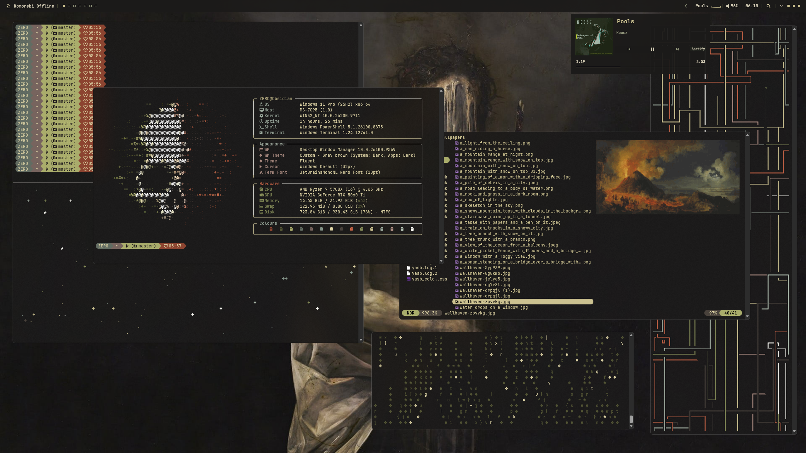

# zero-terminal

A customised Windows terminal environment with a dark charcoal background, warm parchment text, muted greens and rust accents.

Windows Terminal, PowerShell, Oh My Posh and Fastfetch in a cohesive setup, with optional configurations for Yazi, CAVA and FZF.

---

### Preview



*A customised Windows Terminal setup featuring the forgotten knight colour palette, Oh My Posh and Fastfetch.*

---

### Features

- **Windows Terminal** — Custom colours, transparency, fonts and keyboard shortcuts.
- **PowerShell** — Startup configuration, aliases, directory navigation and utility integration.
- **Oh My Posh** — Adaptive prompt with directory, Git and contextual information.
- **Fastfetch** — Custom system information layout and ANSI-coloured ASCII artwork.
- **Yazi** — Themed terminal file manager with customised layout and icons.
- **CAVA** — Minimal audio visualiser with matching colours.
- **FZF** — Styled fuzzy finder with a custom directory preview.

The core setup can be used without installing the optional utilities.

---

### Requirements

**Core**

- Windows 11
- [Windows Terminal](https://github.com/microsoft/terminal)
- Windows PowerShell 5.1 or [PowerShell 7](https://github.com/PowerShell/PowerShell)
- [Oh My Posh](https://ohmyposh.dev/)
- [Fastfetch](https://github.com/fastfetch-cli/fastfetch)
- [JetBrainsMono Nerd Font](https://www.nerdfonts.com/)

**Optional**

- [Yazi](https://github.com/sxyazi/yazi) — Terminal file manager
- [CAVA](https://github.com/karlstav/cava) — Audio visualiser
- [FZF](https://github.com/junegunn/fzf) — Fuzzy finder
- [Zoxide](https://github.com/ajeetdsouza/zoxide) — Directory navigation
- [Eza](https://github.com/eza-community/eza) — Enhanced file listings and previews

Applications are not included in this repository and must be installed separately.

---

### Installation

1. Download or clone this repository.
2. Back up your existing terminal and PowerShell configuration files.
3. Install the core requirements listed above.
4. Review and apply the Windows Terminal configuration from `settings.json`.
5. Copy the Fastfetch configuration and ASCII artwork into your Fastfetch configuration directory.
6. Install the Oh My Posh theme and verify its path in your PowerShell profile.
7. Copy `Microsoft.PowerShell_profile.ps1` into the directory shown by `$PROFILE`.
8. Restart Windows Terminal.

**Important:** Review configuration files before replacing existing settings. Some preferences, paths and installed utilities may differ between systems.

For individual setup instructions and customisation options, follow the guides below.

---

### Configuration

| Component | Files | Guide |
|---|---|---|
| Windows Terminal | `settings.json` | Root configuration |
| Fastfetch | `config.jsonc`, `ascii/arch.txt` | [Fastfetch](fastfetch/README.md) |
| Oh My Posh | `zero-adaptive.omp.json` | [Oh My Posh](ohmyposh/README.md) |
| PowerShell | `Microsoft.PowerShell_profile.ps1` | [PowerShell](powershell/README.md) |
| Yazi | `yazi.toml`, `theme.toml` | [Yazi](extras/yazi/README.md) |
| CAVA | `config` | [CAVA](extras/cava/README.md) |
| FZF | `preview.ps1` | [FZF](extras/fzf/README.md) |

---

### Customisation

**Colours**

ZERO uses a coordinated palette across the terminal, prompt and optional utilities.

| Element | Colour |
|---|---|
| Parchment | `#DCD2A4` |
| Antique gold | `#CBC190` |
| Moss green | `#858C58` |
| Rust | `#C46245` |
| Dark background | `#171814` |

You can adjust these values in the relevant configuration files to create your own variation.

**Font**

JetBrainsMono Nerd Font is recommended for consistent icons and separators. To use another font, update the font face in Windows Terminal.

**Prompt**

Edit `ohmyposh/zero-adaptive.omp.json` to customise prompt segments, symbols and layout.

**Startup**

Edit the PowerShell profile to control Fastfetch startup, command aliases and utility initialisation.

**Optional utilities**

Each folder under `extras/` contains a separate README explaining installation, dependencies and customisation.

---

### Repository Structure

```text
.
├── README.md
├── settings.json
├── assets/
│   └── zero-preview.png
├── fastfetch/
│   ├── config.jsonc
│   ├── ascii/
│   │   └── arch.txt
│   └── README.md
├── ohmyposh/
│   ├── zero-adaptive.omp.json
│   └── README.md
├── powershell/
│   ├── Microsoft.PowerShell_profile.ps1
│   └── README.md
└── extras/
    ├── yazi/
    │   ├── yazi.toml
    │   ├── theme.toml
    │   └── README.md
    ├── cava/
    │   ├── config
    │   └── README.md
    └── fzf/
        ├── preview.ps1
        └── README.md
```

---

### Notes

- This repository contains configuration files, not application installers.
- Optional utilities require separate installation.
- Some PowerShell functions may require additional dependencies or path adjustments.
- Personal scripts and unrelated desktop configurations are not included.
- YASB is maintained separately.
- Back up your existing configuration files before replacing them.

---

### Credits

Built using the open-source tools linked throughout this README.

A personalised terminal environment, made to be adapted.
